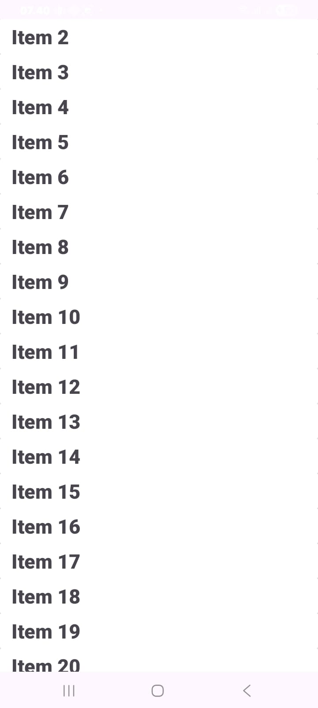
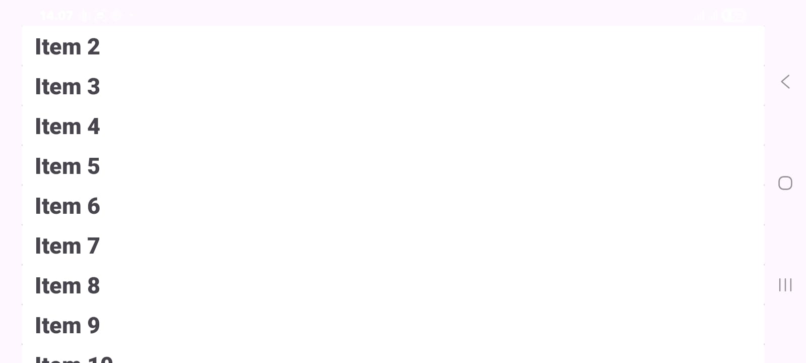

# RecyclerViewSample

Project praktikum **Pengembangan Aplikasi Mobile (PAM)**, Pertemuan 6: *RecyclerView & Adaptive Layout*, **Modul 1**.

Aplikasi Android sederhana yang menampilkan daftar 20 item (`Item 1` sampai `Item 20`) menggunakan `RecyclerView`, dengan setiap item ditampilkan dalam sebuah `CardView`.

## Identitas

| | |
|---|---|
| **Nama** | Fadhillah Rizqia Arfin |
| **NIM** | 1237050056 |
| **Mata Kuliah** | Pengembangan Aplikasi Mobile |

## Fitur

- Menampilkan daftar vertikal berisi 20 item dengan `RecyclerView` dan `LinearLayoutManager`.
- Tampilan satu item dibuat terpisah di `card_view_design.xml` menggunakan `CardView`.
- Data dimodelkan dengan `data class` Kotlin (`ItemsViewModel`).
- Daftar bisa di-scroll sampai item terakhir.
- Jumlah data dicatat ke Logcat menggunakan `Log.d` (tag `test string`).

## Tampilan

<p align="center">
  
</p>


<p align="center">
  
</p>

*Hasil aplikasi saat dijalankan di perangkat: daftar item pada RecyclerView yang di-scroll sampai Item 20.*

## Struktur Project

```
app/src/main/
├── java/lat/pam/recyclerviewsample/
│   ├── MainActivity.kt
│   ├── CustomAdapter.kt
│   └── ItemsViewModel.kt
└── res/layout/
    ├── activity_main.xml
    └── card_view_design.xml
```

## Penjelasan Komponen

| File | Fungsi |
|---|---|
| `ItemsViewModel.kt` | Model data. Menyimpan teks untuk satu item daftar. |
| `card_view_design.xml` | Layout satu item (`CardView` berisi `TextView`). |
| `CustomAdapter.kt` | Adapter yang menghubungkan data (`ItemsViewModel`) ke `RecyclerView` dan menampilkannya lewat `card_view_design.xml`. |
| `activity_main.xml` | Layout utama yang berisi `RecyclerView`. |
| `MainActivity.kt` | Membuat 20 data, memasang `LinearLayoutManager`, dan menghubungkan adapter ke `RecyclerView`. |

## Teknologi

- Kotlin
- Android Studio
- Minimum SDK: API 27 (Android 8.1 "Oreo")
- `RecyclerView` dan `CardView` (AndroidX)

## Cara Menjalankan

1. Clone repository ini:
   ```bash
   git clone https://github.com/Fadhillahrizqia/RecyclerViewSample.git
   ```
2. Buka Android Studio, pilih **File > Open**, lalu pilih folder `RecyclerViewSample` (folder yang berisi `app`, `gradle`, dan `settings.gradle.kts`, bukan folder induknya).
3. Tunggu proses Gradle sync selesai.
4. Pilih emulator atau HP (USB debugging aktif), lalu klik **Run**.

